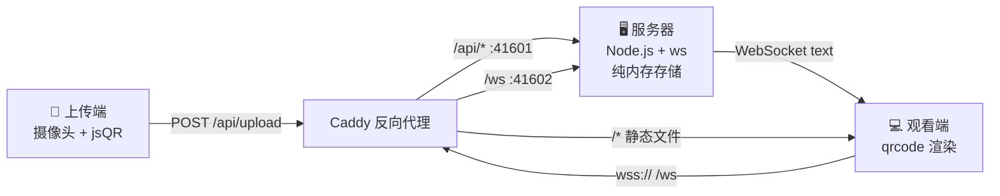
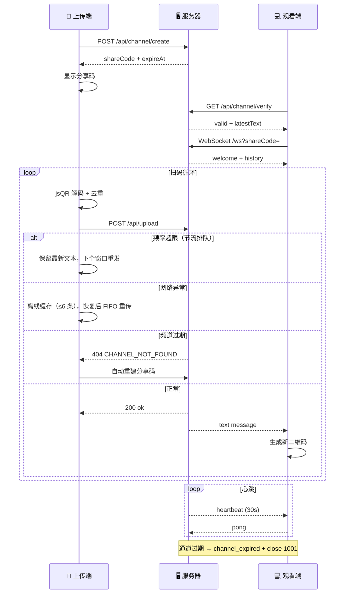

<p align="center">
  
</p>

<h1 align="center">Live QR</h1>

<p align="center">
  实时二维码扫描与展示系统 —— 扫码即传，观看端实时重绘
</p>

<p align="center">
  <a href="https://qr-live.cxs.apps.dynesshely.top"><b>🌐 官方实例</b></a>
  &nbsp;·&nbsp;
  <a href="#快速开始">快速开始</a>
  &nbsp;·&nbsp;
  <a href="#api-参考">API 参考</a>
  &nbsp;·&nbsp;
  <a href="#docker-部署">Docker 部署</a>
  &nbsp;·&nbsp;
  <a href="#免责声明">免责声明</a>
  &nbsp;·&nbsp;
  <a href="LICENSE">许可证</a>
</p>

<p align="center">
  <a href="https://github.com/Dynesshely/Live-QR/stargazers">
    
  </a>
  <a href="LICENSE">
    
  </a>
  
  
  
  
  
  
  
  <a href="https://github.com/Dynesshely/Live-QR/actions/workflows/ci.yml">
    
  </a>
</p>

---

实时二维码扫描与展示系统。上传端通过摄像头扫描二维码并解码为文本，观看端输入 8 位分享码后实时接收文本并重新渲染为二维码。

> **官方实例**：<https://qr-live.cxs.apps.dynesshely.top>

## 免责声明

**本仓库只提供源码，不是一个可以直接运营的公共服务。**

- **公网部署的法律义务由部署者承担。** 将本服务对公众开放，通常涉及实名认证、ICP/公安备案、
  日志留存（例如《网络安全法》要求网络日志留存不少于六个月）、内容审核与应急处置等义务；
  其他法域亦有各自的电信、数据保护与内容监管要求。本仓库不提供任何合规保证，
  以上内容不构成法律意见，部署前请咨询专业人士。
- **官方 Demo 仅供功能体验。** 严禁用于真实业务、生产数据或任何违法、侵权用途；
  Demo 的可用性、数据保留与接口行为均不构成承诺。
- **Demo 的 API 受频率限制，并可能随时变更或下线**，不保证兼容性与可用性。
- **本项目以 AGPL-3.0 分发。** 如果你修改本程序并通过网络向用户提供服务，必须按
  [LICENSE](LICENSE) 向这些用户提供对应的完整源代码。

站内已实现三层合规提示：顶部常驻提示条、首次访问的确认弹窗、页脚常驻的「查看完整条款」入口
（也可用 `#terms` 深链打开）。文案在 `web/src/legal/content.ts`。

## 工作原理

### 系统架构



生产环境由外层网关（如 EdgeOne / openresty）终止 TLS，容器内的 Caddy 只提供 HTTP：
`/api/*` → 41601，`/ws` → 41602，其余为静态文件。

### 数据流时序



## 快速开始

### 本地开发

```bash
# 服务端
cd server
pnpm install
pnpm dev          # → http://localhost:41601

# Web 面板
cd web
pnpm install
pnpm dev          # → http://localhost:41605（已内置 /api 代理）
```

本地开发不需要 `.env`（默认值即 41601/41602）。需要调参时把模板放到 **server 目录**：
`cp .env.example server/.env` —— server 的 dotenv 从**进程工作目录**读取 `.env`；
web 端除 Vite 自身的 `VITE_*` 外不读取环境变量。

可用命令（server / web 各自独立，没有 root script）：

```bash
pnpm build        # 生产构建
pnpm typecheck    # TypeScript 类型检查
pnpm lint         # ESLint 代码检查
pnpm format       # Prettier 代码格式化
pnpm test         # 运行单元测试（单次）
pnpm test:watch   # 运行单元测试（监听模式）
pnpm icon         # 重新生成 Logo/Favicon（web 目录下，见下）
```

CI 在 push / pull request 时对两个包分别跑 `test` + `typecheck` + `build` + `lint`
（`.github/workflows/ci.yml`），四个门禁对 server 与 web 都阻断。

### 图标

品牌图标只有**一份几何定义** —— `web/scripts/render-icon.mjs` 里的 `ICON`，
执行 `pnpm icon`（在 `web/` 下）一次性生成 `assets/logo.svg`、
`web/public/favicon.svg`、`favicon-32.png` 与 `apple-touch-icon.png`。

之所以用脚本而不是手写 SVG：同一图形需要 SVG（可缩放，浏览器 favicon）与
PNG（iOS 的 `apple-touch-icon` 不认 SVG）两种形态，手写会散落在四五个文件里。
脚本用 `node:zlib` 手写 PNG 编码、用解析式 SDF + 超采样做抗锯齿，
不依赖任何外部光栅化器（`rsvg-convert` / `inkscape` / `cairosvg` 均不需要）。

改图形请改 `ICON` 常量后重跑，不要手改生成的产物。

### Docker 部署

```bash
cp .env.example .env      # 可选：不创建也能用内置默认值
docker compose up -d --build

# 访问 http://localhost:41606
```

> 需要 **Docker Compose ≥ 2.24**（`env_file` 的 `required: false` 语法）。
> 更旧的版本请把 `docker-compose.yml` 里的 `env_file` 改成短语法 `env_file: [.env]`，
> 并先创建 `.env`。

> **端口**：宿主机 **41606** → 容器 80。可由 `.env` 的 `LIVE_QR_PORT` 修改。
> （`41605` 是本地 Vite 开发端口，与 Docker 部署无关。）

默认情况下 **TLS 在外层网关/边缘终止**，容器内 Caddy 只监听 `:80`：

- 前置反代（EdgeOne、Nginx、Caddy 等）负责证书与 HTTPS，再以 HTTP 转发到 `41606`。
- 旧版本文档里的 `CADDY_DOMAIN` / `CADDY_EMAIL` **从未被任何代码读取**，已删除；
  现在唯一的站点地址开关是 `.env` 的 `CADDY_SITE_ADDRESS`（默认 `:80`）。

运维要点：

- **健康检查**：镜像内置 `HEALTHCHECK`（请求 `/api/health`），`docker compose ps` 可看到
  healthy/unhealthy；compose 另有一份等价定义，便于按解析后的 `PORT_HTTP` 探活。
- **信号与监督**：容器以 `tini` 为 PID 1，`entrypoint.sh` 把 SIGTERM 转发给 Node 与 Caddy；
  任一进程意外退出，容器随之退出（`restart: unless-stopped` 会重启），不会「进程死了容器还绿」。
- **非 root**：运行用户 uid 10001，通过 `setcap cap_net_bind_service` 获得绑定 80/443 的能力。
- **构建产物不含测试**：server 阶段用 `tsconfig.build.json`（排除 `*.test.ts`）编译，
  镜像里不再出现 `*.test.js`。
- **生产公网部署前须评估所在法域合规义务**（备案、日志留存、内容审核等），
  详见上方[免责声明](#免责声明)。

<details>
<summary>可选：让 Caddy 在容器内自动申请 HTTPS 证书</summary>

仅当没有外层网关替你终止 TLS 时才需要：

1. `.env` 里设 `CADDY_SITE_ADDRESS=qr.example.com`（真实可解析的域名）；
2. 打开 `docker-compose.yml` 里 `443:443` 与 `caddy-data` 卷的注释；
3. 确保 80/443 都能从公网到达（ACME 验证需要），且没有别的代理在前面终止 TLS。

证书与 ACME 状态保存在 `/srv/caddy/data`，必须持久化，否则每次重建都会重新申请。
</details>

## 技术栈

| 层级     | 技术                                                        |
| -------- | ----------------------------------------------------------- |
| 后端     | Node.js 22 + Express 5 + `ws`                              |
| 前端     | Vue 3 + Vite 6 + Tailwind CSS 4（CSS-first）                 |
| 配置校验 | Zod + dotenv（启动时校验，非法值立即报错）                   |
| 二维码   | jsQR（解码）+ qrcode（生成）                                 |
| 代码规范 | ESLint（flat config）+ Prettier                              |
| 测试     | Vitest + supertest（server）/ happy-dom（web）               |
| 反向代理 | Caddy（安全头 + gzip/zstd 压缩）                             |
| 容器化   | Docker 三阶段构建（Node 22 Alpine + Caddy + tini，非 root）  |
| CI       | GitHub Actions（test / typecheck / build / lint）             |
| 数据存储 | 纯内存（`Map<string, ChannelState>`），无数据库              |

## 项目结构

```
Live-QR/
├── .develop/
│   ├── Requirements.md            # 原始需求（历史，顶部有实现差异说明）
│   ├── Enhancements #1.md         # 早期技术栈改进（部分过时，见文内标注）
│   ├── HANDOFF.md                 # 当前状态交接文档（权威）
│   └── HANDOFF-AUDIT.md           # 2026-10-30 审计记录 + 处理状态
├── .github/
│   └── workflows/
│       └── ci.yml                 # push / PR 跑 test + typecheck + build + lint
├── assets/
│   └── logo.svg                   # 项目 Logo（由 web/scripts/render-icon.mjs 生成）
├── server/
│   ├── eslint.config.js           # ESLint flat config
│   ├── tsconfig.build.json        # 生产构建配置（排除 *.test.ts）
│   ├── vitest.config.ts           # Vitest 配置
│   └── src/
│       ├── index.ts               # 进程入口（仅直接运行时启动）
│       ├── server.ts              # createServers 装配 · 双端口 · 信号处理
│       ├── app.ts                 # Express 应用工厂
│       ├── config.ts              # Zod 配置校验 + dotenv
│       ├── types.ts               # 类型与 WS 消息定义
│       ├── logger.ts              # 结构化 JSON 日志 + 访问日志
│       ├── routes/
│       │   ├── channel.ts         # POST /create · GET /verify · POST /expire
│       │   └── upload.ts          # POST /upload
│       ├── services/
│       │   ├── channelStore.ts    # 内存通道管理 + 广播 + 过期
│       │   └── attemptStore.ts    # 限流窗口计数（可清理）
│       ├── ws/
│       │   └── handler.ts         # WebSocket 服务器（握手校验 / 心跳）
│       └── middleware/
│           ├── accessLog.ts       # 每请求一行 JSON（不含文本）
│           ├── validate.ts        # shareCode 校验（先于限流）
│           ├── rateLimiter.ts     # 滑动窗口限流（上传 / 验证 / 创建）
│           └── errorHandler.ts    # 全局错误处理 + JSON 404 兜底
├── web/
│   ├── eslint.config.js           # ESLint flat config (Vue SFC)
│   ├── vitest.config.ts           # Vitest 配置
│   ├── scripts/
│   │   └── render-icon.mjs        # Logo 单一几何定义 → 生成 SVG + PNG（pnpm icon）
│   ├── public/
│   │   ├── favicon.svg            # Favicon（矢量，浏览器首选）
│   │   ├── favicon-32.png         # Favicon 位图回退
│   │   └── apple-touch-icon.png   # iOS「添加到主屏幕」图标（iOS 不认 SVG favicon）
│   └── src/
│       ├── App.vue                # 根组件（首页/扫描/观看）+ 合规弹窗挂载
│       ├── brand.ts               # APP_NAME 单一来源（品牌名不进 i18n）
│       ├── i18n.ts                # 首访语言探测 + 首屏 <html lang>
│       ├── style.css              # Tailwind CSS v4 入口
│       ├── components/
│       │   ├── BrandMark.vue           # 品牌图标（引用 favicon.svg，避免多处内联）
│       │   ├── ScannerView.vue        # 摄像头扫码界面
│       │   ├── QRDisplay.vue          # 二维码展示卡片
│       │   ├── ShareCodeInput.vue     # 8 位分享码输入
│       │   ├── StatusIndicator.vue    # 6 态连接状态灯
│       │   ├── HistoryList.vue        # 历史文本列表（≤200 条）
│       │   ├── FooterBar.vue          # 页脚（版权 / 条款入口 / GitHub）
│       │   ├── LegalBanner.vue        # 顶部合规提示条（第一层）
│       │   ├── LegalConsentDialog.vue # 首次访问确认弹窗（第二层）
│       │   └── LegalTermsDialog.vue   # 完整条款弹窗（第三层，#terms 深链）
│       ├── legal/
│       │   └── content.ts         # 中英日三语合规文案（纯数据）
│       ├── locales/
│       │   └── {zh,en,ja}.json    # UI 文案（各 87 键，键集合一致性有测试）
│       ├── stores/
│       │   └── preferences.ts     # app-preferences（主题 / 语言）
│       ├── utils/
│       │   ├── fetch.ts           # 带超时/AbortController 的 fetch
│       │   ├── upload.ts          # 上传结果分类 + 去重基准 + 错误码映射
│       │   ├── ws.ts              # WS 关闭码分类
│       │   └── scan.ts            # object-cover 裁切与解码区域一致性
│       └── composables/
│           ├── useScanner.ts      # 摄像头 + 离线队列 + 节流排队
│           ├── useWebSocket.ts    # WS 连接 + 指数退避重连
│           ├── useQRCode.ts       # QR 生成封装（1024px 位图/H 级/边距 4）
│           └── useLegal.ts        # 合规弹窗状态 + localStorage/#terms 深链
├── Caddyfile                      # 反向代理（安全头 + 压缩）
├── Dockerfile                     # 三阶段构建
├── docker-compose.yml             # 单服务编排（env_file + 健康检查）
├── entrypoint.sh                  # 容器入口（信号转发 + 进程监督）
└── .env.example                   # 环境变量模板（含取值范围说明）
```

## API 参考

### 通用约定

- 所有响应都是 JSON —— **未知路径也返回 JSON 404**，不再是 HTML。
- 响应有四种形状：① `{code, data}`（create）；② `{code, message}`（upload / expire）；
  ③ **扁平** `{code, valid, latestText, updatedAt}`（verify，没有 `data` 包裹）；
  ④ `{status:"ok"}`（health，没有 `code`）。
- 失败统一为 `{ "code": <4xx|5xx>, "error": "CODE", "message": "..." }`（message 为服务端中文，前端只认 error）。
- `shareCode` 恒为 **8 位数字**（`^\d{8}$`）。
- 请求体上限由 `MAX_TEXT_LENGTH` 推导（**至少 16 KiB**），超限返回 413；
  非法 JSON 返回 400。带 body 的请求应使用 `Content-Type: application/json`。
- 通道只存在于内存：进程重启即全部丢失；过期是**逻辑过期 + 惰性过期**，
  过期后对所有读接口表现为「不存在」，且不会被上传复活。
- 每个请求记一行 JSON 访问日志（method / path / status / durationMs / ip / ua），
  **不记录请求体与上传文本**；`/api/health` 不记日志。

### 接口总览

| 方法   | 路径                             | 说明                          |
| ------ | -------------------------------- | ----------------------------- |
| `POST` | `/api/channel/create`            | 申请通道（可选 `expire_seconds`） |
| `POST` | `/api/upload`                    | 上传/覆盖最新文本             |
| `GET`  | `/api/channel/verify`            | 校验分享码并取最新文本        |
| `POST` | `/api/channel/expire`            | 主动关闭通道                  |
| `GET`  | `/api/health`                    | 探活（无访问日志）            |

### 分享码申请

```http
POST /api/channel/create
Content-Type: application/json

{ "expire_seconds": 1800 }    # 可选；整数，范围 [60, 7200]
```

```json
// 201 Created
{
  "code": 201,
  "data": { "shareCode": "12345678", "expireAt": "...", "createdAt": "..." }
}
```

- `expire_seconds` **真实生效**：创建时冻结为通道自身的 TTL（不传则用
  `CHANNEL_TTL_SECONDS`）。每次上传都会重置计时（创建也算一次活动），
  通道存活期 = 最后一次上传 + TTL。
- 非数字、非整数或超出范围 → `400 INVALID_EXPIRE_SECONDS`（字符串不再被静默忽略）。
- 每 IP 每分钟最多 `CREATE_RATE_LIMIT` 次（默认 10），超限 → `429 CREATE_RATE_LIMITED`。
- 无法分配（撞码等）→ `503 SERVICE_UNAVAILABLE`。

### 文本上传

```http
POST /api/upload
Content-Type: application/json

{ "shareCode": "12345678", "text": "扫描到的文本内容" }
```

```json
// 200 OK
{ "code": 200, "message": "ok" }
```

- 覆盖式语义：通道只保留最新一条文本，历史记录在观看端本地维护（≤200 条）。
- 长度按 **Unicode 码点** 计数（emoji 算 1 个），上限 `MAX_TEXT_LENGTH`。
- 纯空白文本 → `400 TEXT_EMPTY`。
- 通道不存在或已过期 → `404 CHANNEL_NOT_FOUND`。
- 每通道每秒最多 `UPLOAD_RATE_LIMIT` 次 → `429 RATE_LIMITED`。
  限流在参数校验之后，非法请求不消耗额度。

### 分享码验证

```http
GET /api/channel/verify?shareCode=12345678
```

```json
// 200 OK（注意是扁平结构，没有 data 字段）
{ "code": 200, "valid": true, "latestText": "...", "updatedAt": "..." }
```

`latestText` 为 `null`（尚未上传）时，`updatedAt` 也是 `null`。
错误：`400 INVALID_SHARE_CODE` / `404 CHANNEL_NOT_FOUND` / `429 VERIFY_RATE_LIMITED`
（分享码格式错误不消耗限流额度）。

### 主动关闭通道

```http
POST /api/channel/expire
Content-Type: application/json

{ "shareCode": "12345678" }
```

```json
// 200 OK
{ "code": 200, "message": "ok" }
```

通道已不存在/已过期时为 `404 CHANNEL_NOT_FOUND`。在线观看者会收到
`channel_expired` 消息，随后连接以 `1001` 关闭。

### 健康检查

```http
GET /api/health
```

```json
{ "status": "ok" }
```

无 `code` 字段，不写访问日志；容器 `HEALTHCHECK` 与外部探活都打这里。

## WebSocket 实时通道

```
wss://<host>/ws?shareCode=12345678
```

- **只有 `/ws`（含末尾斜杠）是合法路径**，其它路径在握手阶段被拒绝
  （HTTP 403 `FORBIDDEN_PATH`）。
- `shareCode` 缺失或不是 8 位数字 → 握手失败（HTTP 400 `INVALID_SHARE_CODE`），
  不会得到 WebSocket 关闭码。
- **Origin 校验**：默认同源 —— Origin 的 host 必须等于请求 Host；没有 Origin 的
  非浏览器客户端放行。可用 `WS_ALLOWED_ORIGINS` 配置白名单（逗号分隔，`*` 表示任意）；
  不在白名单内 → HTTP 403 `FORBIDDEN_ORIGIN`。

**服务端 → 客户端：**

| 消息类型          | 说明                                | 附带字段                              |
| ----------------- | ----------------------------------- | ------------------------------------- |
| `welcome`         | 连接成功                            | `shareCode`, `viewerCount`          |
| `history`         | 连接前最新文本（≤1 条）             | `messages[]`                         |
| `text`            | 新上传的文本                        | `data`, `timestamp`（Unix ms）      |
| `viewer_count`    | 观看者数量变化（加入/离开时广播）   | `count`                              |
| `channel_expired` | 通道即将关闭                        | `code:"CHANNEL_EXPIRED"`, `message` |
| `heartbeat`       | 心跳（每 30 秒）                    | `serverTime`                          |

`channel_expired.message` 仅为兼容保留，**不要用它做 UI 文案** —— 前端只认 `code`。

**客户端 → 服务端：**

| 消息类型 | 说明     |
| -------- | -------- |
| `pong`   | 心跳响应 |

**关闭码：**

| 关闭码 | 含义                                                                 |
| ------ | -------------------------------------------------------------------- |
| `1001` | 通道过期 / 主动关闭（**先**收到 `channel_expired`，通道确实已不存在） |
| `1012` | 服务端重启（Service Restart，无消息）——通道可能仍存在，**可重连** |
| `4001` | 握手阶段通道不存在（**仅此场景**；缺 `shareCode` 是 HTTP 400，不是 4001） |
| `4002` | 观看者已满（`MAX_VIEWERS_PER_CHANNEL`）                               |
| `1006` | 非正常断开：心跳超时被服务端 `terminate`，或网络中断（无关闭帧）      |

> 前端 `utils/ws.ts`：**1001 = 已过期、不重连**；**1012 = 重启、走指数退避重连**（保留最后一屏二维码，
> 约 31 秒窗口内服务恢复即可自愈）；4001/4002 都不重连。两者的语义边界必须保持，
> 否则要么「重启后全员卡在过期态」，要么「通道真没了还在无限重连」。

**心跳策略：**

- 服务端每 30 秒发送 `heartbeat`；
- 客户端 60 秒内没有收到任何消息 → 判定断线并触发重连；
- 服务端连续 2 个 tick（约 60 秒）未收到 `pong` → 直接 `terminate`
  （客户端看到 1006）。旧文档的心跳超时数值与实现不符，已按代码更正。

**断线重连：** 指数退避 `1s → 2s → 4s → 8s → 16s`，最多 5 次
（旧文档写的固定封顶值不存在：第 5 次退避只有 16s）。重连期间保留最后一个二维码画面。

## 错误码

| 状态码 | error                    | 说明                                                              |
| ------ | ------------------------ | ----------------------------------------------------------------- |
| 400    | `INVALID_SHARE_CODE`     | 分享码格式无效（非 8 位数字）                                     |
| 400    | `TEXT_EMPTY`             | 文本为空或仅含空白                                                |
| 400    | `TEXT_TOO_LONG`          | 文本超过 `MAX_TEXT_LENGTH`（按 Unicode 码点）                     |
| 400    | `INVALID_EXPIRE_SECONDS` | `expire_seconds` 不是整数或不在 [60, 7200]                       |
| 400    | `INVALID_JSON`           | 请求体不是合法 JSON                                               |
| 413    | `PAYLOAD_TOO_LARGE`      | 请求体超过上限（由 `MAX_TEXT_LENGTH` 推导，≥16 KiB）              |
| 404    | `CHANNEL_NOT_FOUND`      | 分享码不存在或已过期                                              |
| 404    | `NOT_FOUND`              | 未知路径（JSON 兜底，不再返回 HTML）                              |
| 429    | `RATE_LIMITED`           | 上传频率超限（`UPLOAD_RATE_LIMIT` 次/秒/通道）                    |
| 429    | `VERIFY_RATE_LIMITED`    | 验证频率超限（`VERIFY_RATE_LIMIT` 次/分钟/IP）                    |
| 429    | `CREATE_RATE_LIMITED`    | 创建频率超限（`CREATE_RATE_LIMIT` 次/分钟/IP）                    |
| 500    | `INTERNAL_ERROR`         | 未预期异常                                                        |
| 503    | `SERVICE_UNAVAILABLE`    | 暂时无法分配通道                                                  |

> `TOO_MANY_VIEWERS`（4002）**不是 HTTP 错误码**，它只出现在 WebSocket 关闭原因里。

## 环境变量

Docker 部署：把 `.env.example` 复制到**仓库根**的 `.env`（compose 会自动读取并注入容器；
未创建 `.env` 时使用下列默认值）。本地开发：放到 `server/.env`（server 的 dotenv 从
进程工作目录读取）。所有值经 Zod 校验，非法值（如 `PORT_HTTP=abc`）会在启动时
立即报错退出。

| 变量                       | 默认值     | 说明                                                       |
| -------------------------- | ---------- | ---------------------------------------------------------- |
| `PORT_HTTP`               | 41601      | HTTP API 端口（1–65535）                                   |
| `PORT_WS`                 | 41602      | WebSocket 端口（1–65535）                                  |
| `CHANNEL_TTL_SECONDS`     | 1800       | 无上传过期时间（60–86400），也是 `expire_seconds` 的默认值 |
| `CLEANUP_INTERVAL_SECONDS`| 60         | 过期扫描间隔（10–3600）                                    |
| `UPLOAD_RATE_LIMIT`       | 2          | 每通道每秒最大上传（1–100）                                |
| `CREATE_RATE_LIMIT`       | 10         | 每 IP 每分钟最大创建（1–1000）                             |
| `MAX_VIEWERS_PER_CHANNEL` | 50         | 每通道最大观看者（1–500）                                  |
| `VERIFY_RATE_LIMIT`       | 10         | 每 IP 每分钟最大验证（1–1000）                             |
| `MAX_TEXT_LENGTH`         | 2000       | 上传文本最大长度，按码点计（1–10000）                      |
| `TRUST_PROXY`             | `loopback` | Express trust proxy；`false`/跳数/`loopback`/`linklocal`/CIDR |
| `WS_ALLOWED_ORIGINS`      | （空）     | WS Origin 白名单，逗号分隔；空 = 同源校验                  |
| `CADDY_SITE_ADDRESS`      | `:80`      | 仅部署侧：Caddy 站点地址（域名则容器内自动 HTTPS）         |
| `LIVE_QR_PORT`            | 41606      | 仅 compose：宿主机发布的 HTTP 端口                         |

> 旧的 `CADDY_DOMAIN` / `CADDY_EMAIL` 已删除 —— 它们从未被 Caddyfile 或 server 读取，
> 设置它们不会启用 HTTPS。容器内自动 HTTPS 请用 `CADDY_SITE_ADDRESS`，并参见
> 「Docker 部署」里的可选步骤。

## 特性

### 合规提示（三层）

- **顶部告警条** — 首页 / 观看端输入页 / 观看端仪表盘都有常驻提示（全屏扫码页刻意不占用取景），
  关闭状态只存当前会话（sessionStorage），刷新后重新出现。
- **首次访问确认** — 阻断式弹窗，同意记录写 localStorage `live-qr-legal-consent-v1`；
  存储不可用时降级为每次都提示，不会假装已同意。
- **完整条款入口** — 页脚常驻「查看完整条款」，也可用 `#terms` 直接深链打开。
  文案在 `web/src/legal/content.ts`（中/英/日），改服务端日志字段时必须同步该文件。

### 上传端

- **去重上传** — 仅文本变化时才上传，避免重复流量
- **节流排队** — 限流时保留最新文本，下个窗口自动发送（合并中间态，保证 ≤2 次/秒）
- **离线缓存** — 网络异常时缓存最多 6 条到内存队列，恢复后 FIFO 重传（带去重）
- **自动重建** — 频道过期后自动申请新分享码并恢复扫描，UI 通知"会话已过期，已自动重建"
- **上传反馈** — 每次上传实时显示成功/失败/限流状态

### 观看端

- **断线重连** — 指数退避（1s → 2s → 4s → 8s → 16s），最多 5 次，期间保留最后一个二维码
- **重连去重** — WebSocket 重连时 `history` 消息自动去重
- **实时人数** — 通过 `viewer_count` 消息更新观看者数量
- **响应式布局** — 适配 PC / 平板 / 手机，二维码最小 200px
- **6 态连接指示** — 未连接 / 验证中 / 等待数据 / 已连接 / 重连中 / 已过期
- **历史记录** — 倒序列表，最多 200 条，含时间戳

### 服务端

- **配置校验** — Zod 运行时校验所有环境变量，非法值立即报错
- **滑动窗口限流** — 上传（每通道）、验证与创建（每 IP）；上传/验证先校验后限流，
  非法请求不占额度
- **真实 TTL** — `expire_seconds` 写入通道自身 TTL；扫描 + 惰性过期双保险
- **WebSocket 心跳** — 30s 间隔；连续 60s 无 pong 即断开；60s 无消息客户端重连
- **协议校验** — 只接受 `/ws`，默认同源 Origin 校验，可配白名单
- **统一错误映射** — 非法 JSON 400、超限 413、未知路径 JSON 404、5xx 兜底
- **访问日志** — 每请求一行 JSON，不含请求体与用户文本（合规需要）
- **优雅关闭** — SIGTERM/SIGINT 时并行关闭 WS + HTTP server，容器内由 tini 转发信号
- **安全响应头** — `X-Content-Type-Options`, `X-Frame-Options`, `Strict-Transport-Security`
- **静态压缩** — gzip + zstd

### 部署

- **单容器** — Caddy + Node.js 打包为一个镜像
- **一键启动** — `docker compose up -d`（`.env` 可选，默认值可用）
- **多阶段构建** — web 构建 → server 构建 → 运行时（不含测试代码）
- **非 root + tini** — uid 10001 运行，PID 1 负责回收与信号转发
- **健康检查** — 镜像与 compose 均探 `/api/health`，进程假活会被判 unhealthy
- **TLS 边缘终止** — 默认纯 HTTP，交给外层网关；也可选用容器内自动 HTTPS

## Star History

<p align="center">
  <a href="https://star-history.com/#Dynesshely/Live-QR&Date">
    
  </a>
</p>

## 许可证

本项目基于 [GNU Affero General Public License v3.0](LICENSE) 发布。

Live QR Copyright (C) 2026 Dynesshely
This program comes with ABSOLUTELY NO WARRANTY.
This is free software, and you are welcome to redistribute it under certain conditions.
