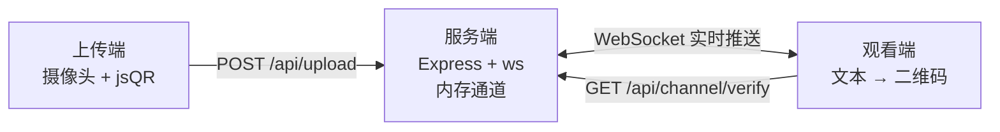

<p align="center">
  <a href="https://qr-live.cxs.apps.dynesshely.top">
    
  </a>
</p>

<h1 align="center">Live QR</h1>

<p align="center">
  扫码即传，实时重绘 —— 基于 WebSocket 的实时二维码投递系统
</p>

<p align="center">
  <a href="https://qr-live.cxs.apps.dynesshely.top"><b>在线体验</b></a>
  &nbsp;·&nbsp;
  <a href="#架构">架构</a>
  &nbsp;·&nbsp;
  <a href="#快速开始">快速开始</a>
  &nbsp;·&nbsp;
  <a href="#部署">部署</a>
  &nbsp;·&nbsp;
  <a href="#接口概览">接口概览</a>
  &nbsp;·&nbsp;
  <a href="#设计要点">设计要点</a>
  &nbsp;·&nbsp;
  <a href="#许可与声明">许可与声明</a>
</p>

<p align="center">
  <a href="https://github.com/Dynesshely/Live-QR/stargazers">
    
  </a>
  <a href="LICENSE">
    
  </a>
  <a href="https://github.com/Dynesshely/Live-QR/actions/workflows/ci.yml">
    
  </a>
  <a href="https://nodejs.org/">
    
  </a>
  <a href="https://www.typescriptlang.org/">
    
  </a>
  <a href="https://vuejs.org/">
    
  </a>
  <a href="https://expressjs.com/">
    
  </a>
  <a href="https://tailwindcss.com/">
    
  </a>
  <a href="https://vite.dev/">
    
  </a>
  <a href="https://docs.docker.com/">
    
  </a>
</p>

---

## 这是什么

上传端用摄像头扫码（jsQR）把二维码解码为文本，观看端凭 8 位分享码建立 WebSocket，实时接收文本并重新生成二维码。两端不需要登录，也不直接通信。

- **扫码即传**：上传端只做「扫 → 解码 → POST」，不在本地保存历史。
- **实时重绘**：服务端通过 WebSocket 推送最新文本，观看端每收到一次就重绘二维码。
- **无数据库**：通道保存在进程内存，默认 30 分钟无上传即过期。

> 官方实例：<https://qr-live.cxs.apps.dynesshely.top>

## 架构



生产环境由外层网关终止 TLS；容器内 Caddy 把 `/api/*` 转到 41601、`/ws` 转到 41602，其余请求返回前端静态资源。

## 技术栈

| 层 | 选型 |
| --- | --- |
| 前端 | Vue 3 · Vite 6 · Tailwind CSS 4 · Pinia |
| 服务端 | Node.js 22 · Express 5 · `ws` |
| 二维码 | jsQR（解码）· qrcode（生成） |
| 配置 | Zod + dotenv（启动即校验） |
| 测试 | Vitest · supertest · happy-dom |
| 交付 | Docker 多阶段构建（Caddy + tini + 非 root）· GitHub Actions |

## 快速开始

```bash
# 服务端（默认 41601，WebSocket 41602）
cd server && pnpm install && pnpm dev

# 前端（默认 41605，已内置 /api 代理）
cd web && pnpm install && pnpm dev
```

不创建 `.env` 也能以默认值运行；需要调参时 `cp .env.example server/.env`。
两个包各自提供 `pnpm test` / `typecheck` / `lint` / `build`，CI 对两者全量执行。

## 部署

```bash
cp .env.example .env       # 可选
docker compose up -d --build
# → http://localhost:41606
```

- 单容器：Caddy + Node.js，uid 10001 非 root，tini 负责信号转发与进程回收。
- TLS 默认交给外层网关，容器内 Caddy 只监听 `:80`；需要容器内自动 HTTPS 时设置 `CADDY_SITE_ADDRESS`。
- 审计日志默认写入命名卷 `live-qr-logs`；`docker compose down` 保留，`down -v` 删除。

## 接口概览

| 方法 | 路径 | 说明 |
| --- | --- | --- |
| `POST` | `/api/channel/create` | 申请通道，返回 8 位分享码与过期时间 |
| `POST` | `/api/upload` | 上传/覆盖最新文本 |
| `GET` | `/api/channel/verify` | 校验分享码并读取最新文本 |
| `POST` | `/api/channel/expire` | 主动关闭通道 |
| `GET` | `/api/health` | 健康检查 |

实时通道为 `/ws?shareCode=xxxxxxxx`，服务端推送 `welcome` / `history` / `text` / `viewer_count` / `channel_expired` / `heartbeat`。
关闭码语义：`1001` 已过期、`1012` 服务重启可重连、`4001` 通道不存在、`4002` 观看者已满。

## 设计要点

- **状态在内存里**：通道是 `Map<shareCode, ChannelState>`，无数据库；重启即清空，过期用惰性判断 + 定时扫描双保险。
- **限流在通道粒度**：上传按「通道/秒」，创建与验证按「IP/分钟」；先校验参数再扣额度，非法请求不占配额。
- **上传端抗抖动**：内容未变不重传；被限流时保留最新一条排队，下个窗口合并发送；断网时内存队列（≤6 条）FIFO 重传。
- **观看端重连语义**：指数退避 1s → 16s；`1012` 重启可重连、`1001` 过期不重连，避免「已过期还在重连」或「重启后卡死」。
- **审计可追溯**：可选地把文本原文、上传者与接收者的 IP/UA 写入磁盘 JSONL（UTC 按天切分、默认保留 243 天，写入失败不影响业务）。

## 配置

全部环境变量及默认值见 [`.env.example`](.env.example)，启动时由 Zod 校验，非法值直接退出。

## 许可与声明

本项目以 [GNU Affero General Public License v3.0](LICENSE) 分发；修改本程序并通过网络提供服务时，必须向这些用户提供完整源代码。

本仓库只提供源码，**不是可直接运营的公共服务**：公网部署涉及的实名、备案、日志留存、内容审核等法律义务由部署者承担；官方 Demo 仅用于功能体验，请勿上传真实业务数据。站内已内置三层合规提示（顶部提示条 / 首次确认 / 完整条款），文案见 `web/src/legal/content.ts`。

## Star History

<p align="center">
  <a href="https://star-history.com/#Dynesshely/Live-QR&Date">
    
  </a>
</p>
