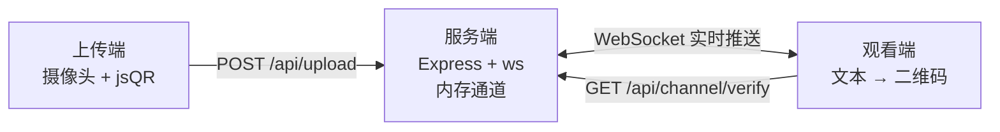
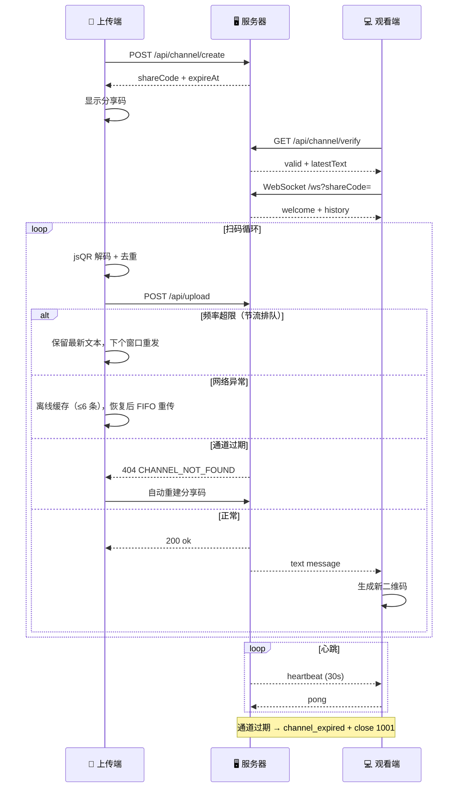

<p align="center">
  <a href="https://qr-live.cxs.apps.dynesshely.top">
    
  </a>
</p>

<h1 align="center">Live QR</h1>

<p align="center">
  扫码即传，实时重绘 —— 基于 WebSocket 的实时二维码投递系统
</p>

<p align="center">
  <a href="https://qr-live.cxs.apps.dynesshely.top"><b>在线体验</b></a>
  &nbsp;·&nbsp;
  <a href="#架构">架构</a>
  &nbsp;·&nbsp;
  <a href="#快速开始">快速开始</a>
  &nbsp;·&nbsp;
  <a href="#部署">部署</a>
  &nbsp;·&nbsp;
  <a href="#api-参考">API 参考</a>
  &nbsp;·&nbsp;
  <a href="#错误码">错误码</a>
  &nbsp;·&nbsp;
  <a href="#环境变量">环境变量</a>
  &nbsp;·&nbsp;
  <a href="#设计要点">设计要点</a>
  &nbsp;·&nbsp;
  <a href="#许可与声明">许可与声明</a>
</p>

<p align="center">
  <a href="https://github.com/Dynesshely/Live-QR/stargazers">
    
  </a>
  <a href="LICENSE">
    
  </a>
  <a href="https://github.com/Dynesshely/Live-QR/actions/workflows/ci.yml">
    
  </a>
  <a href="https://nodejs.org/">
    
  </a>
  <a href="https://www.typescriptlang.org/">
    
  </a>
  <a href="https://vuejs.org/">
    
  </a>
  <a href="https://expressjs.com/">
    
  </a>
  <a href="https://tailwindcss.com/">
    
  </a>
  <a href="https://vite.dev/">
    
  </a>
  <a href="https://docs.docker.com/">
    
  </a>
</p>

---

## 这是什么

上传端用摄像头扫码（jsQR）把二维码解码为文本，观看端凭 8 位分享码建立 WebSocket，实时接收文本并重新生成二维码。两端不需要登录，也不直接通信。

- **扫码即传**：上传端只做「扫 → 解码 → POST」，不在本地保存历史。
- **实时重绘**：服务端通过 WebSocket 推送最新文本，观看端每收到一次就重绘二维码。
- **无数据库**：通道保存在进程内存，默认 30 分钟无上传即过期。

> 官方实例：<https://qr-live.cxs.apps.dynesshely.top>

## 架构



生产环境由外层网关终止 TLS；容器内 Caddy 把 `/api/*` 转到 41601、`/ws` 转到 41602，其余请求返回前端静态资源。

### 数据流时序



## 技术栈

| 层 | 选型 |
| --- | --- |
| 前端 | Vue 3 · Vite 6 · Tailwind CSS 4 · Pinia |
| 服务端 | Node.js 22 · Express 5 · `ws` |
| 二维码 | jsQR（解码）· qrcode（生成） |
| 配置 | Zod + dotenv（启动即校验） |
| 测试 | Vitest · supertest · happy-dom |
| 交付 | Docker 多阶段构建（Caddy + tini + 非 root）· GitHub Actions |

## 快速开始

```bash
# 服务端（默认 41601，WebSocket 41602）
cd server && pnpm install && pnpm dev

# 前端（默认 41605，已内置 /api 代理）
cd web && pnpm install && pnpm dev
```

不创建 `.env` 也能以默认值运行；需要调参时 `cp .env.example server/.env`。
两个包各自提供 `pnpm test` / `typecheck` / `lint` / `build`，CI 对两者全量执行。

## 部署

```bash
cp .env.example .env       # 可选
docker compose up -d --build
# → http://localhost:41606
```

- 单容器：Caddy + Node.js，uid 10001 非 root，tini 负责信号转发与进程回收。
- TLS 默认交给外层网关，容器内 Caddy 只监听 `:80`；需要容器内自动 HTTPS 时设置 `CADDY_SITE_ADDRESS`。
- 审计日志默认写入命名卷 `live-qr-logs`；`docker compose down` 保留，`down -v` 删除。

## API 参考

### 通用约定

- 所有响应都是 JSON —— **未知路径也返回 JSON 404**，不再是 HTML。
- 响应有四种形状：① `{code, data}`（create）；② `{code, message}`（upload / expire）；
  ③ **扁平** `{code, valid, latestText, updatedAt}`（verify，没有 `data` 包裹）；
  ④ `{status:"ok"}`（health，没有 `code`）。
- 失败统一为 `{ "code": <4xx|5xx>, "error": "CODE", "message": "..." }`（message 为服务端中文，前端只认 error）。
- `shareCode` 恒为 **8 位数字**（`^\d{8}$`）。
- 请求体上限由 `MAX_TEXT_LENGTH` 推导（**至少 16 KiB**），超限返回 413；
  非法 JSON 返回 400。带 body 的请求应使用 `Content-Type: application/json`。
- 通道只存在于内存：进程重启即全部丢失；过期是**逻辑过期 + 惰性过期**，
  过期后对所有读接口表现为「不存在」，且不会被上传复活。
- 每个请求记一行 JSON **访问日志**（method / path / status / durationMs / ip / ua），
  不含请求体；`/api/health` 不记日志。**审计日志是另一套子系统**，会保存上传文本原文
  （默认开启），字段与开关见[环境变量](#环境变量)中的 `AUDIT_LOG_*`。

### 接口总览

| 方法   | 路径                             | 说明                          |
| ------ | -------------------------------- | ----------------------------- |
| `POST` | `/api/channel/create`            | 申请通道（可选 `expire_seconds`） |
| `POST` | `/api/upload`                    | 上传/覆盖最新文本             |
| `GET`  | `/api/channel/verify`            | 校验分享码并取最新文本        |
| `POST` | `/api/channel/expire`            | 主动关闭通道                  |
| `GET`  | `/api/health`                    | 探活（无访问日志）            |

### 分享码申请

```http
POST /api/channel/create
Content-Type: application/json

{ "expire_seconds": 1800 }    # 可选；整数，范围 [60, 7200]
```

```json
// 201 Created
{
  "code": 201,
  "data": { "shareCode": "12345678", "expireAt": "...", "createdAt": "..." }
}
```

- `expire_seconds` **真实生效**：创建时冻结为通道自身的 TTL（不传则用
  `CHANNEL_TTL_SECONDS`）。每次上传都会重置计时（创建也算一次活动），
  通道存活期 = 最后一次上传 + TTL。
- 非数字、非整数或超出范围 → `400 INVALID_EXPIRE_SECONDS`（字符串不再被静默忽略）。
- 每 IP 每分钟最多 `CREATE_RATE_LIMIT` 次（默认 10），超限 → `429 CREATE_RATE_LIMITED`。
- 无法分配（撞码等）→ `503 SERVICE_UNAVAILABLE`。

### 文本上传

```http
POST /api/upload
Content-Type: application/json

{ "shareCode": "12345678", "text": "扫描到的文本内容" }
```

```json
// 200 OK
{ "code": 200, "message": "ok" }
```

- 覆盖式语义：通道只保留最新一条文本，历史记录在观看端本地维护（≤200 条）。
- 长度按 **Unicode 码点** 计数（emoji 算 1 个），上限 `MAX_TEXT_LENGTH`。
- 纯空白文本 → `400 TEXT_EMPTY`。
- 通道不存在或已过期 → `404 CHANNEL_NOT_FOUND`。
- 每通道每秒最多 `UPLOAD_RATE_LIMIT` 次 → `429 RATE_LIMITED`。
  限流在参数校验之后，非法请求不消耗额度。

### 分享码验证

```http
GET /api/channel/verify?shareCode=12345678
```

```json
// 200 OK（注意是扁平结构，没有 data 字段）
{ "code": 200, "valid": true, "latestText": "...", "updatedAt": "..." }
```

`latestText` 为 `null`（尚未上传）时，`updatedAt` 也是 `null`。
错误：`400 INVALID_SHARE_CODE` / `404 CHANNEL_NOT_FOUND` / `429 VERIFY_RATE_LIMITED`
（分享码格式错误不消耗限流额度）。

### 主动关闭通道

```http
POST /api/channel/expire
Content-Type: application/json

{ "shareCode": "12345678" }
```

```json
// 200 OK
{ "code": 200, "message": "ok" }
```

通道已不存在/已过期时为 `404 CHANNEL_NOT_FOUND`。在线观看者会收到
`channel_expired` 消息，随后连接以 `1001` 关闭。

### 健康检查

```http
GET /api/health
```

```json
{ "status": "ok" }
```

无 `code` 字段，不写访问日志；容器 `HEALTHCHECK` 与外部探活都打这里。

### 实时通道（WebSocket）

实时通道为 `/ws?shareCode=xxxxxxxx`，服务端推送 `welcome` / `history` / `text` / `viewer_count` / `channel_expired` / `heartbeat`。
关闭码语义：`1001` 已过期、`1012` 服务重启可重连、`4001` 通道不存在、`4002` 观看者已满。

## 错误码

| 状态码 | error                    | 说明                                                              |
| ------ | ------------------------ | ----------------------------------------------------------------- |
| 400    | `INVALID_SHARE_CODE`     | 分享码格式无效（非 8 位数字）                                     |
| 400    | `TEXT_EMPTY`             | 文本为空或仅含空白                                                |
| 400    | `TEXT_TOO_LONG`          | 文本超过 `MAX_TEXT_LENGTH`（按 Unicode 码点）                     |
| 400    | `INVALID_EXPIRE_SECONDS` | `expire_seconds` 不是整数或不在 [60, 7200]                       |
| 400    | `INVALID_JSON`           | 请求体不是合法 JSON                                               |
| 413    | `PAYLOAD_TOO_LARGE`      | 请求体超过上限（由 `MAX_TEXT_LENGTH` 推导，≥16 KiB）              |
| 404    | `CHANNEL_NOT_FOUND`      | 分享码不存在或已过期                                              |
| 404    | `NOT_FOUND`              | 未知路径（JSON 兜底，不再返回 HTML）                              |
| 429    | `RATE_LIMITED`           | 上传频率超限（`UPLOAD_RATE_LIMIT` 次/秒/通道）                    |
| 429    | `VERIFY_RATE_LIMITED`    | 验证频率超限（`VERIFY_RATE_LIMIT` 次/分钟/IP）                    |
| 429    | `CREATE_RATE_LIMITED`    | 创建频率超限（`CREATE_RATE_LIMIT` 次/分钟/IP）                    |
| 500    | `INTERNAL_ERROR`         | 未预期异常                                                        |
| 503    | `SERVICE_UNAVAILABLE`    | 暂时无法分配通道                                                  |

> `TOO_MANY_VIEWERS`（4002）**不是 HTTP 错误码**，它只出现在 WebSocket 关闭原因里。

## 环境变量

Docker 部署：把 `.env.example` 复制到**仓库根**的 `.env`（compose 会自动读取并注入容器；
未创建 `.env` 时使用下列默认值）。本地开发：放到 `server/.env`（server 的 dotenv 从
进程工作目录读取）。所有值经 Zod 校验，非法值（如 `PORT_HTTP=abc`）会在启动时
立即报错退出。

| 变量                       | 默认值     | 说明                                                       |
| -------------------------- | ---------- | ---------------------------------------------------------- |
| `PORT_HTTP`               | 41601      | HTTP API 端口（1–65535）                                   |
| `PORT_WS`                 | 41602      | WebSocket 端口（1–65535）                                  |
| `CHANNEL_TTL_SECONDS`     | 1800       | 无上传过期时间（60–86400），也是 `expire_seconds` 的默认值 |
| `CLEANUP_INTERVAL_SECONDS`| 60         | 过期扫描间隔（10–3600）                                    |
| `UPLOAD_RATE_LIMIT`       | 2          | 每通道每秒最大上传（1–100）                                |
| `CREATE_RATE_LIMIT`       | 10         | 每 IP 每分钟最大创建（1–1000）                             |
| `MAX_VIEWERS_PER_CHANNEL` | 50         | 每通道最大观看者（1–500）                                  |
| `VERIFY_RATE_LIMIT`       | 10         | 每 IP 每分钟最大验证（1–1000）                             |
| `MAX_TEXT_LENGTH`         | 2000       | 上传文本最大长度，按码点计（1–10000）                      |
| `TRUST_PROXY`             | `loopback` | Express trust proxy；`false`/跳数/`loopback`/`linklocal`/CIDR |
| `WS_ALLOWED_ORIGINS`      | （空）     | WS Origin 白名单，逗号分隔；空 = 同源校验                  |
| `AUDIT_LOG_ENABLED`       | `true`     | 审计日志开关（true/false/1/0）；开启后落盘**明文文本**     |
| `AUDIT_LOG_DIR`           | `logs`     | 审计日志目录；容器内固定 `/var/log/live-qr`（命名卷）      |
| `AUDIT_LOG_RETENTION_DAYS`| 243        | 保留天数（1–3650，约 8 个月；按 UTC 日期切文件）           |
| `CADDY_SITE_ADDRESS`      | `:80`      | 仅部署侧：Caddy 站点地址（域名则容器内自动 HTTPS）         |
| `LIVE_QR_PORT`            | 41606      | 仅 compose：宿主机发布的 HTTP 端口                         |

> 旧的 `CADDY_DOMAIN` / `CADDY_EMAIL` 已删除 —— 它们从未被 Caddyfile 或 server 读取，
> 设置它们不会启用 HTTPS。容器内自动 HTTPS 请用 `CADDY_SITE_ADDRESS`（需 80/443
> 可从公网到达，并持久化 Caddy 的证书与 ACME 卷）。

## 设计要点

- **状态在内存里**：通道是 `Map<shareCode, ChannelState>`，无数据库；重启即清空，过期用惰性判断 + 定时扫描双保险。
- **限流在通道粒度**：上传按「通道/秒」，创建与验证按「IP/分钟」；先校验参数再扣额度，非法请求不占配额。
- **上传端抗抖动**：内容未变不重传；被限流时保留最新一条排队，下个窗口合并发送；断网时内存队列（≤6 条）FIFO 重传。
- **观看端重连语义**：指数退避 1s → 16s；`1012` 重启可重连、`1001` 过期不重连，避免「已过期还在重连」或「重启后卡死」。
- **审计可追溯**：可选地把文本原文、上传者与接收者的 IP/UA 写入磁盘 JSONL（UTC 按天切分、默认保留 243 天，写入失败不影响业务）。

## Star History

<p align="center">
  <a href="https://star-history.com/#Dynesshely/Live-QR&Date">
    
  </a>
</p>

## 许可与声明

本项目以 [GNU Affero General Public License v3.0](LICENSE) 分发；修改本程序并通过网络提供服务时，必须向这些用户提供完整源代码。

本仓库只提供源码，**不是可直接运营的公共服务**：公网部署涉及的实名、备案、日志留存、内容审核等法律义务由部署者承担；官方 Demo 仅用于功能体验，请勿上传真实业务数据。站内已内置三层合规提示（顶部提示条 / 首次确认 / 完整条款），文案见 `web/src/legal/content.ts`。
